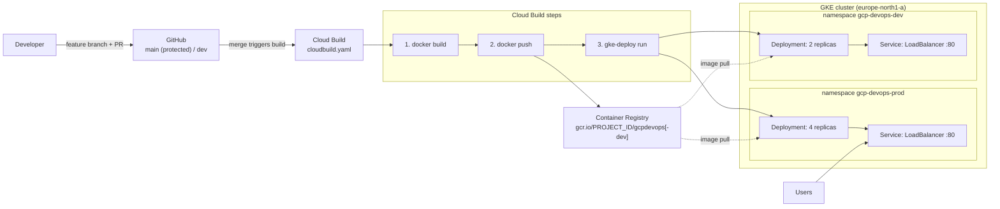

# GCP Cloud Build pipeline: push-to-deploy on GKE

   

A CI/CD pipeline on Google Cloud: a merged pull request triggers Cloud Build, which builds a Docker image, pushes it to the registry and deploys it to Google Kubernetes Engine.

The project ran two environments from two branches (`main` → prod, `dev` → dev), so changes were tested in dev before they reached production. This repository contains the production configuration; the dev branch differed only in image name, namespace and replica count, shown [below](#environments).

The application is deliberately small (a Flask "hello" service). The focus is the delivery path around it: branch protection, PR-gated merges, a serverless build pipeline, and per-environment deployments on a shared GKE cluster.

## Architecture



## How it works

1. **Source control.** `main` is protected: every change goes feature branch → pull request → review → merge, never a direct push.
2. **Trigger.** A Cloud Build trigger on each branch fires when a PR is merged.
3. **Build and push.** Cloud Build builds the image from the `Dockerfile` and pushes it to Container Registry.
4. **Deploy.** The `gke-deploy` builder applies `gke.yaml` to the cluster, substituting the freshly built image, in the namespace for that branch.
5. **Expose.** A `LoadBalancer` Service publishes the app on port 80 and forwards to the container on port 5000.

### Environments

| | Production | Development |
|---|---|---|
| Branch (during the project) | `main` | `dev` |
| Image | `gcr.io/$PROJECT_ID/gcpdevops` | `gcr.io/$PROJECT_ID/gcpdevops-dev` |
| Namespace | `gcp-devops-prod` | `gcp-devops-dev` |
| Replicas | 4 | 2 |

Each branch carried its own `cloudbuild.yaml` and `gke.yaml`, so the environments were deployed and scaled independently. The files in this repository are the production versions.

## Design decisions

| Decision | Why |
|---|---|
| Cloud Build | Serverless, YAML-defined CI with no build servers to run; native GitHub triggers and a GKE deploy builder |
| `gke-deploy` instead of plain `kubectl apply` | Pins the deployment to the exact image digest that was just built and waits for the rollout |
| `$PROJECT_ID` substitution, no hard-coded project | The same pipeline works in any project; nothing account-specific lives in the repo |
| One cluster, one namespace per environment | Isolates dev from prod without paying for a second cluster |
| Dedicated namespaces instead of `default` | Clear ownership and a place to attach quotas and RBAC later |
| `logging: CLOUD_LOGGING_ONLY` | Required when the build runs as a custom (user-managed) service account |
| Node Auto-Provisioning and Cluster Autoscaler | Nodes are added and removed with demand instead of being sized up front |
| Branch protection and PR-only merges | Every deployment is traceable to a reviewed PR |

## Repository layout

```text
app.py            Flask application (listens on 5000)
Dockerfile        container image
requirements.txt  Python dependencies
cloudbuild.yaml   build -> push -> deploy steps
gke.yaml          Kubernetes Deployment + LoadBalancer Service
```

## Reproduce it

Prerequisites: a Google Cloud project with billing, the `gcloud` CLI, and this repository forked to your GitHub account.

```bash
export PROJECT_ID=<your-project-id>
gcloud config set project "$PROJECT_ID"
gcloud services enable container.googleapis.com cloudbuild.googleapis.com containerregistry.googleapis.com

# 1. Cluster and namespaces
gcloud container clusters create gcp-devops-project --zone europe-north1-a --num-nodes 1 --enable-autoscaling --min-nodes 1 --max-nodes 3
gcloud container clusters get-credentials gcp-devops-project --zone europe-north1-a
kubectl create namespace gcp-devops-prod
kubectl create namespace gcp-devops-dev

# 2. Let Cloud Build deploy to GKE
PROJECT_NUMBER=$(gcloud projects describe "$PROJECT_ID" --format='value(projectNumber)')
gcloud projects add-iam-policy-binding "$PROJECT_ID" \
  --member="serviceAccount:${PROJECT_NUMBER}@cloudbuild.gserviceaccount.com" \
  --role="roles/container.developer"
```

3. Recreate the dev environment: create a `dev` branch and, on it, change three values: the image name `gcpdevops` → `gcpdevops-dev` (in both files), the namespace `gcp-devops-prod` → `gcp-devops-dev` (in both files), and `replicas: 4` → `replicas: 2` in `gke.yaml`.
4. In the Cloud Build console, connect your GitHub repository and create two triggers, both using `cloudbuild.yaml`: one for branch `^main$` and one for `^dev$`.
5. Merge a PR into `dev`, then into `main`, and get the external IPs:

```bash
kubectl get service gcp-devops-gke-service -n gcp-devops-dev
kubectl get service gcp-devops-gke-service -n gcp-devops-prod
```

## Cost and teardown

The GKE free tier covers the management fee of one zonal cluster; you pay for the nodes, each `LoadBalancer` Service (one per environment) and image storage. Delete everything when you're done:

```bash
gcloud container clusters delete gcp-devops-project --zone europe-north1-a
gcloud container images delete gcr.io/$PROJECT_ID/gcpdevops --force-delete-tags
gcloud container images delete gcr.io/$PROJECT_ID/gcpdevops-dev --force-delete-tags
```

Also delete the two Cloud Build triggers, and set a budget alert before you start.

## Next steps

- **Move to Artifact Registry.** Google has deprecated Container Registry (`gcr.io`) in favour of Artifact Registry; the image paths in `cloudbuild.yaml` and `gke.yaml` would change to `REGION-docker.pkg.dev/$PROJECT_ID/<repo>/gcpdevops`.
- **Immutable image tags.** Tag images with `$SHORT_SHA` so every deployment maps to one commit and rollbacks are a single redeploy.
- **Production web server.** Run the app with Gunicorn instead of the Flask development server, and update the base image from Python 3.8 (end of life) to a supported version.
- **Probes and resource limits** on the Deployment, and a test step in `cloudbuild.yaml` before the build.

## Project history

The project was planned and delivered in seven sprints:

| Sprint | Outcome |
|---|---|
| 1 | GitHub repository with branch protection and a PR workflow; containerized Flask app tested locally |
| 2 | GCP account with budget alerts; GKE cluster with Node Auto-Provisioning and Cluster Autoscaler |
| 3 | Pipeline design: Cloud Build for builds, a container registry for images, GKE for runtime |
| 4 | Cloud Build trigger on `main`; `cloudbuild.yaml` builds and pushes the image on every merge |
| 5 | Dedicated namespace and Deployment; Cloud Build extended to deploy to GKE |
| 6 | `LoadBalancer` Service exposing the application |
| 7 | Separate `dev` branch and environment with its own replica count; promote dev → prod |
